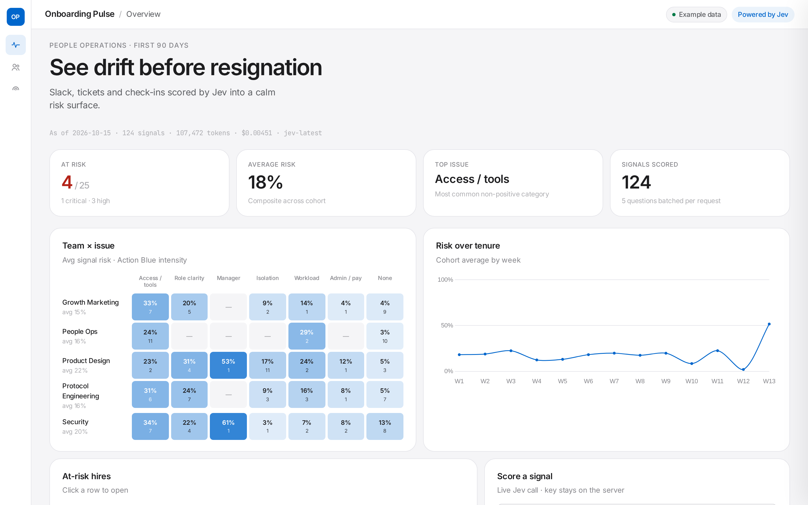

# Onboarding Pulse

**First-90-day attrition radar for People Ops** — powered by [Jev](https://typesafe.ai) (TypeSafe System One).

> **Example data** — all names, tickets and quotes are fictional. Built as a launchable MVP for Omoniyi Ipaye (People Ops, Consensys / Madrid).

New hires leave in the first 90 days for reasons that are often visible in Slack questions, IT tickets, check-in surveys and buddy notes — but nobody joins those signals up. Onboarding Pulse scores each signal with Jev, then shows which hires, teams and onboarding steps are at risk of early attrition.




## Design

Light product UI combining **Apple** (museum whitespace, Action Blue `#0066cc`), **Tesla** (radical subtraction, calm headlines), and **Linear** (8px radius, hairline panels, dense tables). Motion uses the same ease curve as [omoniyios.com](https://www.omoniyios.com) (`cubic-bezier(0.16, 1, 0.3, 1)`).

Live demo on the site: [omoniyios.com/pulse](https://www.omoniyios.com/pulse) (set `TYPESAFE_API_KEY` in Vercel for live scoring).

## Quick start

```bash
cd onboarding-pulse
python3 -m venv .venv
source .venv/bin/activate
pip install fastapi uvicorn requests playwright
# API key (already used for the scored demo):
#   ~/.config/typesafe/api_key   or   export TYPESAFE_API_KEY=...

# Re-score example data (optional — data/scores.json is already present)
python score_signals.py

# Run the dashboard
python app.py
# → http://127.0.0.1:8080
```

## What you get

| Surface | What it shows |
| --- | --- |
| KPI cards | Hires at risk, average risk, top issue, signals scored |
| Team × issue heatmap | Where friction concentrates (access, role clarity, isolation…) |
| Risk-over-tenure chart | Cohort risk by week of tenure (W1–W13) |
| At-risk table | Ranked hires with evidence quotes + Jev probabilities |
| Hire drill-down | Full signal timeline for one person |
| Score new signal | Live Jev call from the backend (key never leaves the server) |

## Architecture

```
Slack / tickets / surveys / buddy notes
        │
        ▼
  example_signals.json   ← EXAMPLE cohort (25 hires, 124 signals)
        │
        ▼
  score_signals.py       ← 1 Jev request per signal, 5 questions batched
        │
        ▼
  scores.json            ← cached answers + hire/team rollups
        │
        ▼
  FastAPI app.py :8080   ← dashboard + /api/score (live)
        │
        ▼
  templates/index.html   ← single-page UI
```

- **Code owns the workflow.** Jev returns typed judgments; risk weights, thresholds and trends live in Python.
- **API key** is read from `~/.config/typesafe/api_key` (or `TYPESAFE_API_KEY`). It is never sent to the browser.
- Endpoint: `POST https://api.typesafe.ai/v1/systemone` with model `jev-latest`.

## Jev questions (batched per signal)

Every signal is one request with five questions:

| Id | Type | Asks |
| --- | --- | --- |
| `category` | Choice | Primary issue: `access_tools`, `role_clarity`, `manager_support`, `social_isolation`, `workload`, `admin_payroll`, `none` |
| `frustration` | Score | 4 levels: calm → highly frustrated |
| `confusion` | Score | 4 levels: clear → very confused |
| `intent_to_leave` | Noul | Signals intent to leave / regret joining? |
| `blocked_from_work` | Noul | Currently blocked from core work? |

### Composite risk (code)

```
risk = 0.20 * (frustration/3)
     + 0.15 * (confusion/3)
     + 0.40 * intent_to_leave
     + 0.25 * blocked_from_work
```

Hire risk blends average, recent (last 3) and peak signal risk. Levels: critical ≥ 0.45, high ≥ 0.28, medium ≥ 0.18.

## Real Jev usage (this demo)

Scored from `data/example_signals.json` on 2026-10-15:

| Metric | Value |
| --- | --- |
| Signals / requests | 124 (5 questions each, batched) |
| Model | `jev-1.13.0` via `jev-latest` |
| Input tokens | 107,472 |
| Output tokens | free |
| Price | $0.042 / MTok input |
| **Cost** | **~$0.0045** |
| Wall time | ~1.3 s (8 concurrent workers) |

Live `/api/score` calls cost ~850 input tokens each (~$0.000036).

## Project layout

```
onboarding-pulse/
├── app.py                 # FastAPI backend
├── score_signals.py       # Batch scorer + rollups
├── data/
│   ├── example_signals.json
│   └── scores.json
├── templates/index.html
├── static/
├── screenshot.png
├── README.md
└── .venv/
```

## Launch next steps

### 1. Data connectors
- **Slack** — ingest `#help`, DMs to People Ops bot, and new-hire channels (message text only; strip @mentions of non-cohort people).
- **IT / HR tickets** — Jira Service Management, Zendesk, or Linear labels `onboarding` / `access`.
- **Check-ins** — Culture Amp / Lattice / Google Form pulses at days 7 / 30 / 60 / 90.
- **HRIS** — BambooHR, Personio or Workday for start dates, team, manager, location.
- **Buddy notes** — short structured form in the buddy checklist (preferred over free Slack).

### 2. Privacy & GDPR
- Lawful basis: legitimate interest (workforce analytics) or employment contract necessity — document DPIA.
- Prefer **pseudonymised hire IDs** in the scoring store; keep identity map in HRIS with tighter ACLs.
- Minimise: score text snippets, do not retain full Slack threads longer than needed; set retention (e.g. 18 months post-tenure).
- Access: People Ops + hire’s manager only; no peer visibility of individual risk.
- Employee notice in the onboarding privacy statement; works council / employee reps where required (Spain: comité de empresa).
- Do not use scores alone for dismissal or compensation — human decision, Jev as signal.

### 3. Product & pricing ideas
- **Free pilot** — one cohort (≤50 hires), Slack + CSV upload, 90 days.
- **Team** — €299/mo — BambooHR/Personio sync, Slack + tickets, email digests to People Ops.
- **Company** — €799/mo — SSO, manager dashboards, audit export, custom risk weights, EU data residency.
- Upsell: Opskit kit + LinkedIn case study on early-attrition ROI.

### 4. Product polish before launch
- Auth (Google Workspace / Okta).
- Weekly digest email: “3 hires crossed high risk”.
- Alerting when `intent_to_leave` > 0.6 on a new signal.
- A/B the risk weights against known early exits.
- Empty states + connector setup wizard.

## Licence

Demo code for internal / portfolio use. Jev usage subject to [TypeSafe terms](https://docs.typesafe.ai/legal). Example data is fictional.
